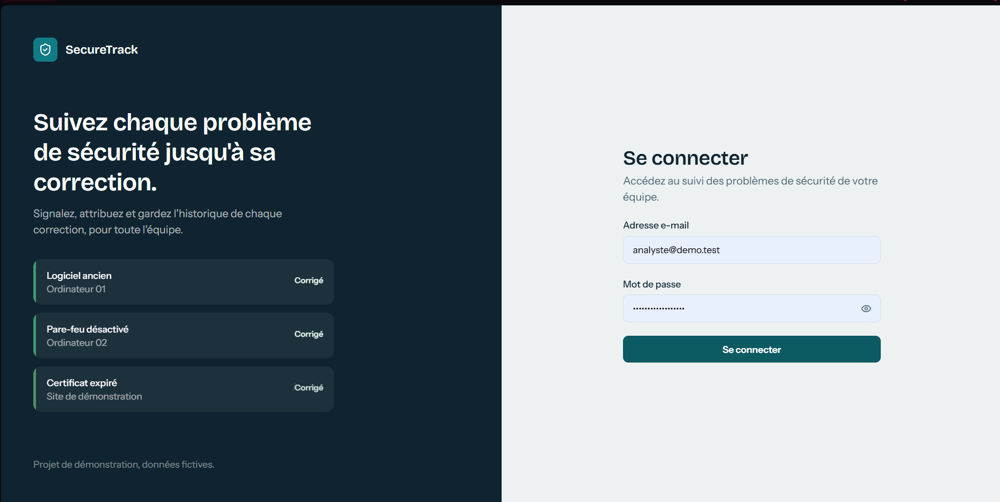
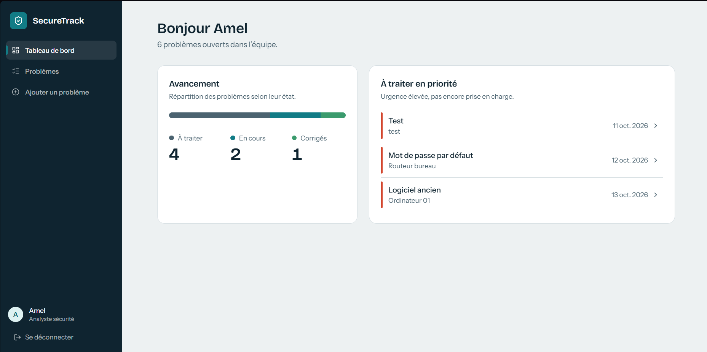
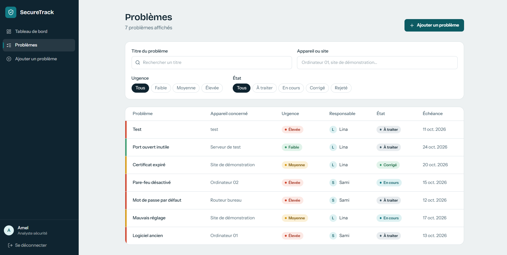
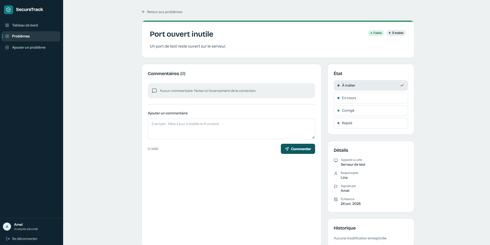

# SecureTrack

Application web de suivi des problèmes de sécurité informatique : une équipe note les problèmes (logiciel ancien, mauvais réglage...), les attribue, suit leur correction et garde un historique.

> Projet de démonstration. Il utilise uniquement des données fictives.

## Captures d'écran

| Connexion                                | Tableau de bord                                    |
| ---------------------------------------- | -------------------------------------------------- |
|  |  |

| Liste et filtres                    | Détail d'un problème                   |
| ----------------------------------- | -------------------------------------- |
|  |  |

## Technologies

- **Frontend** : React (Vite), React Router, TanStack Query, React Hook Form, Zod, Tailwind CSS
- **Backend** : Django et Django REST Framework (authentification par session)
- **Base de données** : PostgreSQL
- **Outils** : Docker Compose, GitHub Actions

## Fonctionnalités

- Connexion par e-mail et mot de passe
- Liste des problèmes avec recherche et filtres (urgence, état, appareil)
- Ajout d'un problème (analyste, administrateur)
- Changement d'état, commentaires et historique des modifications
- Tableau de bord avec compteurs

## Rôles

| Rôle           | Droits                                                                        |
| -------------- | ----------------------------------------------------------------------------- |
| Administrateur | Gère les comptes (interface d'administration Django), voit tous les problèmes |
| Analyste       | Crée, attribue, rejette et consulte tous les problèmes                        |
| Technicien     | Voit uniquement ses problèmes, modifie leur état et ajoute des commentaires   |

## Installation

Prérequis : Docker Desktop et Git.

```bash
git clone https://github.com/Habib101-cmd/securetrack.git
cd securetrack
cp .env.example .env        # Windows PowerShell : Copy-Item .env.example .env
```

Renseignez ensuite `SECRET_KEY`, `DB_USER` et `DB_PASSWORD` dans `.env`, puis :

```bash
docker compose up --build
docker compose exec backend python manage.py migrate
docker compose exec backend python manage.py seed
```

Application : http://localhost:5173 - Administration : http://localhost:8000/admin/

### Comptes de démonstration (fictifs)

| E-mail             | Rôle       |
| ------------------ | ---------- |
| analyste@demo.test | Analyste   |
| sami@demo.test     | Technicien |
| lina@demo.test     | Technicien |

Le mot de passe de démonstration est défini dans `backend/accounts/management/commands/seed.py`.

## Tests

```bash
docker compose exec backend python manage.py test
```

## Sécurité

| Protection                                                  | Où la trouver                                     |
| ----------------------------------------------------------- | ------------------------------------------------- |
| Mots de passe hachés avec Argon2, 10 caractères minimum     | `config/settings.py`                              |
| Contrôle d'accès par rôle côté serveur                      | `issues/permissions.py`, `issues/views.py`        |
| Un technicien ne voit que ses problèmes (404 sinon)         | `IssueViewSet.get_queryset`                       |
| Champs modifiables limités par rôle                         | `IssueViewSet.perform_update`                     |
| Protection CSRF (jeton `X-CSRFToken`)                       | `accounts/views.py`, `frontend/src/api/client.js` |
| Limitation des tentatives de connexion (5 par minute)       | `accounts/views.py`, `config/settings.py`         |
| Message d'erreur de connexion identique, e-mail non révélé  | `LoginView`                                       |
| Validation serveur de tous les champs                       | `issues/serializers.py`                           |
| Requêtes SQL via l'ORM, jamais de SQL construit à la main   | `issues/views.py`                                 |
| Échappement XSS (React, pas de `dangerouslySetInnerHTML`)   | `frontend/src/`                                   |
| Cookies de session HttpOnly, SameSite, Secure en production | `config/settings.py`                              |
| Historique de chaque modification (traçabilité)             | `IssueHistory`                                    |
| Secrets dans `.env`, exclu de Git                           | `.gitignore`                                      |

15 tests automatiques de sécurité vérifient ces règles.

## Améliorations futures

- Notifications par e-mail à l'attribution
- Pièces jointes (captures d'écran)
- Export CSV
- Graphiques d'évolution
- Authentification à deux facteurs
